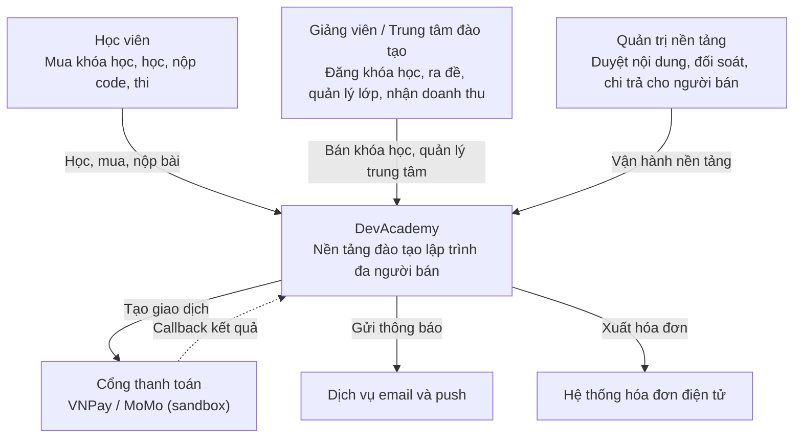

# Sơ đồ C4: mức Context

DevAcademy nhìn từ bên ngoài: ai sử dụng hệ thống và hệ thống giao tiếp với những hệ thống nào.

## Các thành phần

| Thành phần | Loại | Vai trò |
|---|---|---|
| Học viên | Người dùng | Mua khóa học, học, nộp code, tham gia kỳ thi |
| Giảng viên / Trung tâm | Người dùng (người bán) | Đăng khóa học, ra đề bài, quản lý lớp, nhân sự, nhận doanh thu |
| Quản trị nền tảng | Người dùng | Duyệt nội dung, đối soát, chi trả cho người bán |
| Cổng thanh toán | Hệ thống bên ngoài | Xử lý thanh toán, gọi lại (callback) báo kết quả; chỉ dùng sandbox |
| Dịch vụ email và push | Hệ thống bên ngoài | Gửi email, thông báo đẩy tới app MAUI |
| Hóa đơn điện tử | Hệ thống bên ngoài | Xuất hóa đơn theo quy định (từ giai đoạn 3) |

Keycloak, PostgreSQL, Redis, MinIO là các thành phần **bên trong** DevAcademy, sẽ xuất hiện ở sơ đồ mức Container.